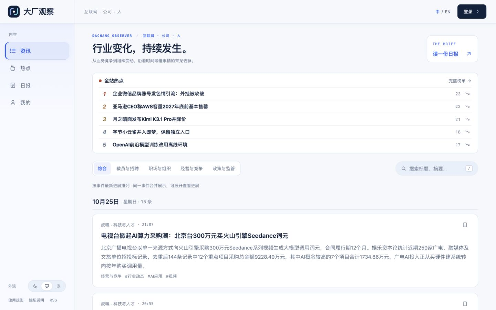
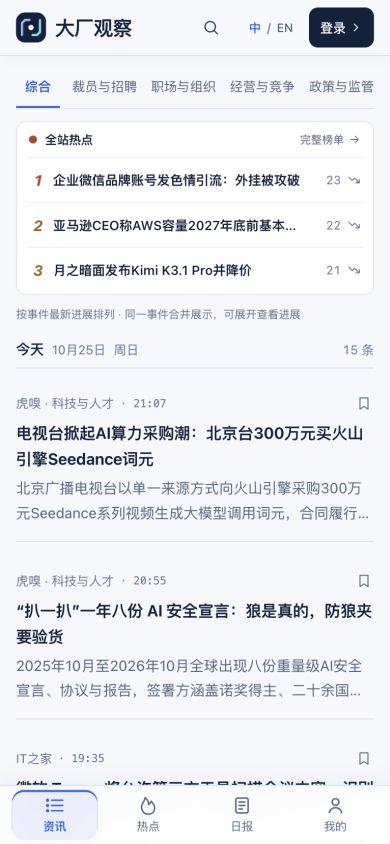
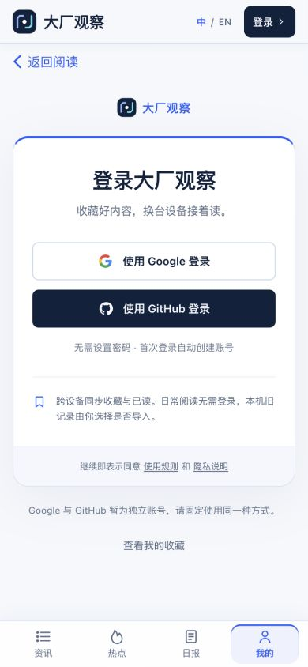
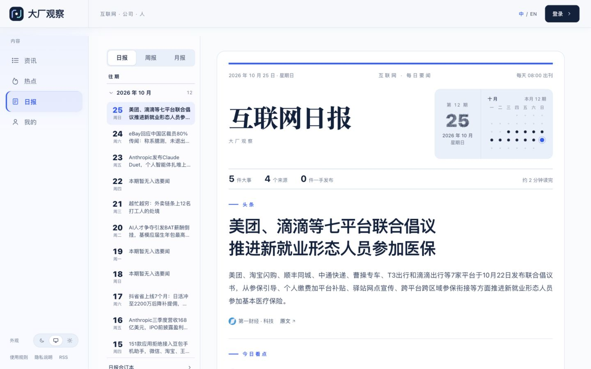
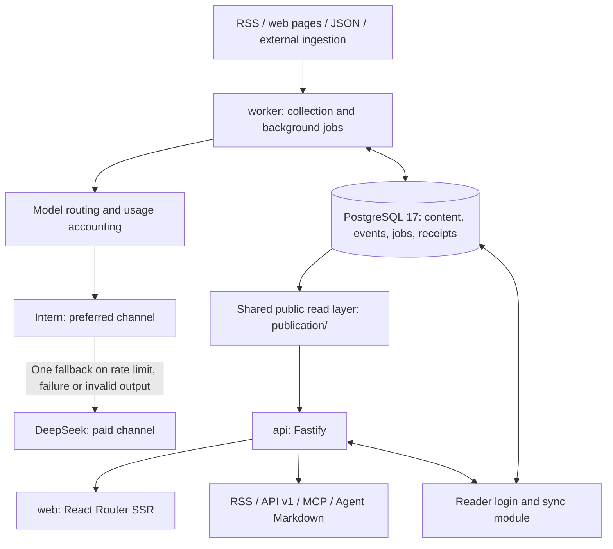

<p align="center"></p>

# Dachang Observer · 大厂观察

> **Construction mode (2026-10-25):** News / Trending / Daily / Me are the four main destinations. Categories are Jobs & hiring, Work & people, Business & competition, and Policy & regulation. Automated selection scores, selected deep analysis and selected full-body translations are paused; code, thresholds, labels and history are retained. New dailies use admitted reports without extra scoring. Existing selected API/RSS semantics remain historical; subscribe to `/feed/all.xml` for continuing updates. See [selection](docs/selection.md).

**Internet. Companies. People.** A news aggregation and reading site for employees at medium and large internet companies, focused on company development, business competition, organizational changes and working life.

[Website](https://innews.site/) · [简体中文](README.md) · [Architecture](docs/architecture.md) · [Source configuration](docs/sources.md) · [Maintenance](docs/maintenance.md)

Thanks to the upstream open-source project [AIHOT](https://github.com/KKKKhazix/AIHOT) for providing the foundation for Dachang Observer.

## Editorial scope and reading features

- Focus on Chinese internet companies and their competitors, including overseas developments with a direct connection to domestic businesses or jobs.
- Cover business performance, competition, hiring and layoffs, pay and performance reviews, reorganizations, staff letters and sourced workplace controversies. Preserve attribution, disputed claims and company responses.
- AI keywords, funding, an ex-big-tech founder or a hiring story do not automatically qualify an article. Merchant tutorials, shopping offers, routine hardware reviews and pure implementation details are not automatically in scope.
- Four reading sections: **Company Developments, Organization & People, Business Competition, Policy & Regulation**. Company Developments covers company-level performance, funding, acquisitions and group strategy; Organization & People includes jobs, pay, work rules and employee conditions; Business Competition covers products, monetization and market moves; Policy & Regulation covers external rules, investigations and penalties. Analysis, interviews and staff letters are formats rather than primary sections.
- Selected news, all news, event-based hotlists, topics and daily/weekly/monthly editions. Related reporting is folded into events with expandable developments and sources.
- Responsive desktop/mobile layouts, light/dark themes, and Chinese/English reading. Every fresh open or reload starts in Chinese; explicitly choosing EN persists through in-site navigation. Translations are prepared in the background, with a visible original-text fallback.
- Optional Google/GitHub reader login synchronizes bookmarks and read history. Anonymous reading remains available. The two providers currently create separate accounts; administrator authentication is separate.

See [Section boundaries and legacy compatibility](docs/categories.md) for classification details.

## Screenshots and getting started

Current anonymous views of the live site; no admin screens, accounts or credentials are included.



<table>
  <tr><th>Mobile news</th><th>Optional reader sign-in</th></tr>
  <tr>
    <td align="center"></td>
    <td align="center"></td>
  </tr>
</table>

<details>
<summary>Daily brief layout</summary>



</details>

Use the [step-by-step setup guide](docs/quick-start.md) (Chinese), or the local instructions below. You can start an empty site with model calls and collection disabled, then configure your own credentials, spending cap and sources. No GPU or local model installation is required.

Use the [All RSS feed](https://innews.site/feed/all.xml) for current news. Set `mode=all` explicitly in API requests, for example `/api/v1/items?mode=all&window=24h&limit=5`; selected endpoints retain historical results. [Contributing](CONTRIBUTING.md) · [Security](SECURITY.md).

## Architecture

Stack: **Node.js ≥ 24.11, TypeScript, React 19, React Router SSR, Fastify, PostgreSQL 17, pg-boss, Tailwind CSS, Docker Compose and Caddy**.



| Component | Location | Responsibility |
| --- | --- | --- |
| Web | `apps/web/` | Pages, navigation, search, login entry and language display; reads the API over HTTP, without database or model credentials |
| API | `apps/api/` | Site and public APIs, RSS, MCP, admin and reader-module routing |
| Worker | `apps/worker/` | Collection, model processing, grouping, hotlists, editions, translation and retries |
| Business logic | `packages/backend/` | Source adapters, content processing, model routing and receipts, events, publication, editions and operations |
| Shared contracts | `packages/contracts/` | API types, taxonomy and module contracts |
| Site and industry configuration | `site/`, `industry/` | Brand, copy, models, taxonomy, topics, sources, prompts and selection thresholds |
| Extensions | `modules/reader/`, `modules/language/` | OAuth and cross-device reading state; English UI/content/edition translations |
| Data and deployment | `database/migrations/`, `deploy/` | Schema migrations, HTTPS, backups and server email jobs |

Public news outputs share `publication/` for visibility, withdrawals, selection and full-text permissions. Accounts and bookmarks use separate private interfaces. Docker's `setup` container migrates and seeds, then exits; web, API, worker and PostgreSQL keep running. Caddy provides HTTPS. Models run at API providers: **no local large-model deployment or GPU is required**.

### Processing pipeline

1. **Collect and trace:** fetch enabled sources, preserve original URLs and publication dates, deduplicate URLs and extract article text as needed. RSS/page downloads normally do not call a language model.
2. **Filter and select:** check relevance first. During construction, relevance screening stays active while automatic scoring is paused. The retained selection mechanism scores candidates twice, then applies source-tier thresholds, evidence and duplicate checks; manual decisions take precedence.
3. **Write and structure:** generate Chinese titles, summaries and applicable recommendation reasons; extract category, tags, entities and current facts. Technical terms or company names alone are not evidence of employee relevance.
4. **Group events:** distinguish identical facts, follow-up developments and unrelated stories. Candidate retrieval uses optional embeddings, or text similarity when embeddings are not configured, followed by model review where needed. Grouping still requires ongoing spot checks.
5. **Rank and publish editions:** event heat uses independent sources and time decay, not page views or Weibo search data. Daily editions use rules; weekly/monthly editions compile dailies, with models assisting only overviews and section introductions.
6. **Serve and translate:** readers receive stored public results. Background workers prepare and validate English translations. **Reading, searching, changing language and signing in do not trigger model calls.**

Edition times use Asia/Shanghai: daily at 08:00, weekly on Monday at 10:00, monthly on day 1 at 10:30; see [`EDITION_TIMES`](site/site.ts). A successfully assessed period with no qualifying stories may have a genuine empty edition; upstream failures must not be disguised as empty editions. Ordinary reruns do not overwrite published snapshots.

## Information sources

### Configuration versus runtime status

The versioned inventory is [`industry/sources.json`](industry/sources.json); adapter documentation is in [Sources](docs/sources.md). **Code snapshot, 2026-10-26: 109 configurations, 87 enabled by default**:

| Adapter | Enabled | Meaning |
| --- | ---: | --- |
| RSS | 51 | Native feeds and explicitly identified third-party RSS bridges |
| Web lists | 26 | Company newsrooms, media sections and official public Weibo pages |
| JSON lists | 8 | Public Jike activity and media JSON data |
| External ingestion | 2 | Receives upstream script submissions; does not poll by itself |

That is **85 polling endpoints (including two isolated lead sources) and 2 ingestion endpoints**, not 87 independent publishers or a guarantee that every endpoint is healthy. Admin settings may differ from seeds. Seeding adds missing sources without overwriting existing settings. Check the backend for current health, last success and errors.

The 2026-10-26 RSS expansion adds four public WeChat bridge feeds and two native feeds. LatePost AI shares its publisher signal group with LatePost; Huxiu RSS shares the Huxiu web group. These are additional access channels, not six independent media organisations. See [source notes](docs/sources.md#公众号转-rss-接入2026-10-26).

### Main configured sources

| Group | Sources |
| --- | --- |
| Chinese business and industry media | 36Kr, Huxiu, Jiemian, 21st Century Business Herald, Yicai, National Business Daily, TMTPost, Leiphone, PingWest, TechNode, LatePost, Shenwang, Yuanchuan Research, Internet Guaitao, Tencent Tech, NetEase Tech, Caijing Magazine, Lishi Business Review, Prism, Narrowcast, Newrank, Game Grape, ChinaVenture, Time Weekly, Lanjing News, CYZone, Silicon Valley 101, YYS, China Newsweek and Woshipm’s industry section |
| Chinese technology and platform news | IT Home, ifanr, cnBeta, MyDrivers, GeekPark, DoNews, Sanyan Tech, Bianews, QbitAI, iFeng Tech, The Paper and Sina Tech |
| Company publications | Alibaba Group Chinese newsroom, Tencent, Meituan, JD, OpenAI, Anthropic, Google, Microsoft and Meta newsrooms/blogs |
| International media | TechCrunch, The Information, CNBC, Bloomberg, The Guardian, BBC, Rest of World, South China Morning Post, Business Insider and Semafor |
| Company and regulator WeChat accounts | CAC China, AliResearch, Tencent Research Institute, DingTalk and Feishu through public RSS bridges |
| Industry author WeChat accounts | Pan Luan’s Luanfanshu and caoz; opinion pieces still require relevance and evidence review |
| Public Jike accounts | Internet Fangjian Bagua, Pan Luan, Lanxi and Weixi; preserve author attribution and evidence limits |
| Official Weibo | Alibaba, Tencent, JD and Meituan; verified company accounts only, no individual Weibo bloggers |
| External ingestion | HubSpot SEC filings and Eastmoney's Jiemian republications; ongoing updates depend on upstream push scripts |

LatePost, Shenwang, Yuanchuan, Internet Guaitao and the 15 new WeChat endpoints use public Wechat2RSS bridges listed in [BestBlogs OPML](https://github.com/ginobefun/BestBlogs/blob/main/opml/bestblogs_wechat2rss_opml_all.opml). **These are not publisher-operated RSS feeds** and may be delayed or unavailable. TMTPost’s failing original RSS (403) is replaced with a bridge from the same directory while retaining its source ID. Many endpoints share this bridge provider, so additional coverage does not remove the shared failure risk. Publisher/author endpoints share a `signal_group_id` for heat counting. A configured URL does not grant copyright or republication permission.

New endpoints still pass scope keyword admission and model relevance checks. Initial import is capped at two candidates per new endpoint. The readable LatePost Dialogue bridge has no posts after 2025 and is not enabled or counted as a new active source.

Added 2026-10-26: [Maimai workplace hotlist leads](docs/sources.md#脉脉职场热榜线索2026-10-26) use a third-party public RSS feed at 120-minute intervals. Admission requires a named internet employer and a workplace or personnel topic. Like V2EX, these are internal isolated leads: no public release, heat contribution or model calls. Missing dates stay unknown. Follow-up media reports, company statements or other traceable evidence must go through normal admission; a hotlist title is not verification.

### Social scope and limitations

- **X:** internet-company official accounts and industry commentators through free public entry points only. Coverage remains incomplete; framework support for paid SocialData is not evidence that this deployment subscribes to it.
- **Weibo and Xiaohongshu:** verified company official accounts only, no personal bloggers. Stable direct access to Xiaohongshu official content remains unfinished and is not counted as an enabled source above.
- **Availability:** Alizila returned 403 and was paused in favour of Alibaba Group’s publicly readable Chinese newsroom, retaining its history. Other endpoints may time out, require login, rate-limit or change structure. Failures are recorded and backed off, rather than treating login pages or empty results as successful collection.
- **Access and rights:** paywalled full text may be unavailable. Publish summaries and original links by default; displaying or syndicating full text requires the appropriate source permission.

Polling uses a **120-minute baseline** per enabled automatic source; failure backoff can extend it. Polling every two hours does not guarantee new articles on each check. Initial imports and old articles retain original publication dates; unknown dates are held from public release rather than replaced with collection timestamps.

Additional independent access (2026-10-25): Economic Observer’s technology page is read directly, and LateTalk uses its publisher-operated podcast RSS (show notes only, no audio transcription). These preserve other content channels during a bridge outage; they are not automatic mirrors of the same WeChat feed. Shared WeChat bridge dependence remains.

## Models and costs

Production attempts the preferred free channel **for each logical model task**, with one paid fallback only if that task encounters a channel problem:

| Work | Preferred | Fallback |
| --- | --- | --- |
| Writing, structure, grouping/review, digests, weekly/monthly assistance and translation | Intern / `deepseek-v4.1-flash-1017`, preset `intern-flash` | Official DeepSeek / `deepseek-flash` |
| Industry relevance screening (active) | Same version with low-effort reasoning, preset `intern-flash-think` | `deepseek-flash-think`; API model name remains `deepseek-flash` |
| Selection scoring (paused; configuration retained) | Same version with low-effort reasoning, preset `intern-flash-think` | `deepseek-flash-think`; API model name remains `deepseek-flash` |

Presets live in [`site/models.ts`](site/models.ts). Effective precedence is **admin settings → environment variables → code defaults**. A fresh checkout still defaults to DeepSeek; adding an Intern key alone does not switch every step. Follow [Routing](docs/model-routing.md) and verify each active choice. The paid official name is a provider alias, not a permanent date-pinned version guarantee.

Free availability depends on platform quotas, RPM/TPM and channel capacity. Paid fallback consumes balance. The current owner has removed the CNY amount cap while retaining request limits, concurrency, kill switches and receipt protection. An unknown request outcome can still have a cost; do not retry blindly. Dashboard/email amounts estimate this site's receipts, not the provider's final bill or other projects using the same key.

## Run locally

Install Node.js ≥ 24.11 and Docker Compose. Never replace an existing production environment with empty settings.

```bash
git clone https://github.com/skynet2000/dachang-observer.git
cd dachang-observer
node scripts/init-env.ts
```

Initialization creates random admin/signing credentials. Fill model credentials in your local `.env`; do not put secrets in shell commands, chat or Git. Collection and model calls default to disabled, so you can inspect an empty site first:

```bash
docker compose up -d --build
```

Open <http://localhost:3000>; admin is at `/admin`. Verify sources and each model step, then set `COLLECT_ENABLED=true` and `MODEL_CALLS_ENABLED=true` in `.env` when ready and run `docker compose up -d`. Initial processing time and cost depend on sources, channel capacity and backlog, rather than a fixed completion time.

Google/GitHub login requires separate OAuth applications, callback configuration and privacy acceptance; it is off by default. See [Reader login](docs/reader-login.md). HTTPS, native development and upgrades are covered in [Deployment](docs/deploy.md).

## Checks and releases

```bash
npm ci
npm run typecheck
DATABASE_URL=postgres://127.0.0.1:5432/changji_test npm test
npm run build -w @aihot/web
node --test apps/web/tests/*.test.ts
python3 -m unittest discover -s deploy/tests
node scripts/smoke.ts --base http://localhost:3000
```

Backend tests require PostgreSQL 17 and an account allowed to create databases. Database names must end in `_test` or `_ci`; never use production. Install browser engines first with `npx playwright install chromium webkit` (`--with-deps` may be needed on Linux). Smoke checks require a running site. Tests use local stubs rather than real collection/model providers. GitHub Actions also verifies Docker startup.

Release order: **checks → backup → push this repository → deploy/migrate → verify the public site**. Git does not synchronize databases, uploaded files, credentials or receipts. Do not run `docker compose down -v` and delete persistent data. See [Migration rules](docs/architecture.md#数据库迁移).

## Operations and documentation

The website and jobs run on a cloud server, independently of the owner's computer; server downtime still affects them.

- **Operating email:** server-side at 09:00 Asia/Shanghai for the previous calendar day, 00:00–24:00: estimated model costs, page requests, estimated UV, popular pages and content output. Partial coverage and missing history are explicitly labeled; no Codex scheduler dependency.
- **Fault email:** server-side checks every five minutes, notifying persistent faults and one recovery. Independent off-server monitoring for complete server/network outages is not yet configured.
- **Backups:** daily same-server backups retain successful copies from the last seven days. Automated offsite backups remain deferred; same-server copies cannot survive total server/disk loss.
- **Ongoing work:** automatic selection is paused with labels and logic retained; reopening requires fresh independent evaluation. Historical grouping and free social-source coverage still need spot checks.
- **Repository safety:** Gitleaks checks full history, while GitHub push protection blocks supported secret types. These do not replace private credential storage or rotation after exposure. See [Security](SECURITY.md).

| Document | Contents |
| --- | --- |
| [Architecture](docs/architecture.md) | Process boundaries, public outputs and migrations |
| [Sources](docs/sources.md) | Adapters, tiers, permissions, timestamps and external ingestion |
| [Selection](docs/selection.md) | Prompts, owner labels and evaluation limits; current thresholds are authoritative in `industry/selection.ts` |
| [Event grouping](docs/grouping.md) | Facts, developments and relationship evaluation |
| [Model routing](docs/model-routing.md) | Preferred channel, paid fallback and receipts |
| [Language](docs/language.md) / [Reader login](docs/reader-login.md) | Translation and account sync |
| [Deployment](docs/deploy.md) / [Maintenance](docs/maintenance.md) | Operation, upgrades, backups and troubleshooting |
| [Server email](docs/cost-email.md) | Cost, fault and recovery notifications |
| [Security reporting](SECURITY.md) | Vulnerability reporting channel |

## Attribution and license

Original copyright notices are retained under the [MIT license](LICENSE). AIHOT's name and logo are not used as this site's brand. Fonts and third-party assets follow [NOTICE](NOTICE). News copyrights remain with their publishers; the code license does not grant rights to republish full articles.
