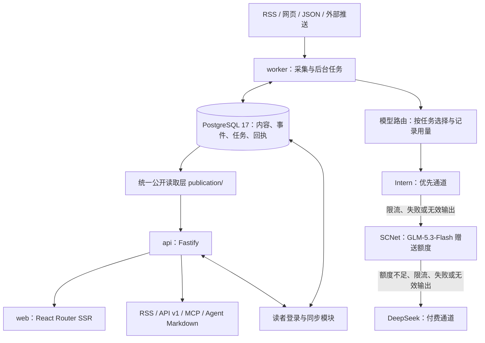

<p align="center"></p>

# 大厂观察 · Dachang Observer

> **建设期模式（2026-10-25）**：主入口为资讯／热点／日报／我的；四个栏目为裁员与招聘、职场与组织、经营与竞争、政策与监管。自动精选评分、精选深度解读及精选全文翻译暂时暂停，相关代码、门槛、标注和历史数据保留。新日报使用全部准入内容，不追加评分。恢复见[精选文档](docs/selection.md)。原精选API/RSS保留历史结果，持续订阅使用`/feed/all.xml`。

**互联网 · 公司 · 人。** 面向互联网中大厂职场人的资讯聚合与阅读网站，关注企业经营、业务竞争、组织人事及员工处境。

[访问网站](https://innews.site/) · [上手教程](docs/quick-start.md) · [English](README.en.md) · [系统架构](docs/architecture.md) · [信源接入](docs/sources.md) · [维护指南](docs/maintenance.md)

感谢上游开源项目 [AIHOT](https://github.com/KKKKhazix/AIHOT) 为大厂观察提供基础框架。

## 内容定位与阅读功能

- **关注对象**：国内互联网中大厂及其竞争企业，兼顾与国内业务和岗位有直接关系的海外动态。
- **重点内容**：企业发展、平台竞争、裁员招聘、薪酬绩效、组织调整、全员信及有出处的员工争议。传闻、员工自述和公司回应保留归因，不将单方说法写成已证实事实。
- **收录边界**：不因出现 AI、融资、前大厂员工或招聘字样就收录；商家运营教程、消费优惠、普通硬件评测和纯技术细节不自动获得收录资格。
- **四个阅读栏目**：裁员与招聘、职场与组织、经营与竞争、政策与监管。员工议题在前，按主要新增事实归类；全员信、爆料、深度分析、AI与公司名作为标签。旧分类链接继续可用。
- **当前主入口**：资讯、热点、日报、我的。精选能力暂时保留停用，主题和订阅等工具的原地址继续可用。相同事件的报道合并展示，可展开查看报道与进展。
- **双语与双端**：手机与桌面适配、浅色/深色外观；每次新打开或刷新默认中文，读者主动选择 EN 后在站内保持英文。英文内容在后台预先生成，缺失时保留原文并提示。
- **可选读者登录**：Google/GitHub 登录后同步收藏与已读；匿名仍可阅读。两种提供商目前为独立账号，不自动合并。管理员使用独立后台登录。

栏目边界与历史兼容规则见 [分类说明](docs/categories.md)。

## 界面预览

以下为当前公开站的真实匿名截图，页面内容会随采集更新。截图不包含后台、登录账号或部署凭据。


<table>
  <tr><th>手机资讯</th><th>可选账号同步</th></tr>
  <tr>
    <td align="center"></td>
    <td align="center"></td>
  </tr>
</table>

<details>
<summary>查看日报版式</summary>


</details>

## 从哪里开始

| 你想做什么 | 从这里进入 |
| --- | --- |
| 直接阅读 | [在线网站](https://innews.site/)；无需注册 |
| 自己跑一个空站 | [从零上手教程](docs/quick-start.md)，先不填写模型密钥也能验收界面 |
| 开始自动更新 | 教程中的“接通模型与采集”，先设置自己的预算、信源和范围 |
| 调整选题与信源 | [行业定制](docs/customize.md)／[信源](docs/sources.md) |
| 部署、升级与排错 | [部署](docs/deploy.md)／[维护](docs/maintenance.md) |
| 贡献或报告问题 | [贡献指南](CONTRIBUTING.md)／[安全报告](SECURITY.md) |

读者订阅使用 [全部资讯 RSS](https://innews.site/feed/all.xml)。公开 API 查询当前资讯时显式使用 `mode=all`，例如 `/api/v1/items?mode=all&window=24h&limit=5`；原精选订阅与接口保留历史结果。完整 RSS/API/MCP 用法见[接入页](https://innews.site/agent)。

## 系统架构

技术栈：**Node.js ≥ 24.11、TypeScript、React 19、React Router SSR、Fastify、PostgreSQL 17、pg-boss、Tailwind CSS、Docker Compose、Caddy**。



| 组件 | 位置 | 职责 |
| --- | --- | --- |
| Web | `apps/web/` | 页面、导航、搜索、登录入口和双语呈现；通过 HTTP 请求 API，不连接数据库或携带模型密钥 |
| API | `apps/api/` | 站内接口、公开 API、RSS、MCP、后台及读者模块路由 |
| Worker | `apps/worker/` | 采集、模型处理、归组、热点、出刊、翻译与任务重试 |
| 核心业务 | `packages/backend/` | 信源适配、内容处理、模型路由与回执、事件、公开读取、刊物和运维 |
| 共享契约 | `packages/contracts/` | 前后端接口类型、分类与模块契约 |
| 站点与行业配置 | `site/`、`industry/` | 品牌、文案、模型预设、分类、主题、信源、提示词和精选门槛 |
| 扩展模块 | `modules/reader/`、`modules/language/` | OAuth 与跨设备阅读记录；界面和资讯、刊物的英文译文 |
| 数据与部署 | `database/migrations/`、`deploy/` | 数据迁移、HTTPS、备份和服务器邮件任务 |

公开资讯出口共用 `publication/`，统一处理公开范围、撤回、精选与全文许可；读者账号和收藏通过独立的私有接口读写。Docker 中 `setup` 负责迁移和信源初始化后退出，`web`、`api`、`worker` 与数据库持续运行，Caddy 提供 HTTPS。服务器通过 API 调用模型，**不需要本地部署大模型或购买 GPU**。

### 一条消息如何进入网站

1. **采集与溯源**：读取已启用信源，保存原始链接、发布时间和来源，去除重复 URL，按需提取正文。RSS/网页下载本身通常不调用模型。
2. **相关性与精选**：先判断是否属于本站范围。建设期只运行行业预筛，自动评分暂停；保留的精选机制会独立评分两次，并结合信源门槛、证据与重复检查决定是否精选。人工标注与纠正优先保留。
3. **写作与结构化**：生成中文标题、摘要和必要的推荐理由，提取主类、标签、主体及当前事实；不将技术名词或公司名直接等同于员工价值。
4. **事件归组**：区分同一事实、后续进展与不同事件；相似召回使用可选向量服务，未配置时使用文本相似度，必要时进行模型复核。去重与人工归组仍需持续抽查。
5. **热点与刊物**：热点按事件的独立来源和时间衰减计算，不是阅读量或微博热搜数据。日报由规则编排；周报、月报从日报汇编，模型只辅助总述与栏目导读。标注“未经独立核实”的帖子仍可出现在刊物中，但不作为模型改写导读的材料。
6. **公开与翻译**：网页等出口读取已保存的公开结果；worker 分批生成并校验英文。**阅读、搜索、切换语言和登录均不触发模型调用。**

默认刊物时间按北京时间：日报每日 08:00、周报周一 10:00、月报每月 1 日 10:30，见 [`EDITION_TIMES`](site/site.ts)。有效评判后零入选可保留真实空刊；上游采集或处理失败不能伪装为空刊。已出刊快照不因普通重跑被覆盖。

## 信息来源

### 配置清单与运行状态

可版本化的信源清单在 [`industry/sources.json`](industry/sources.json)，接入方式见 [信源文档](docs/sources.md)。**2026-10-28 代码配置快照：113 个配置项，默认启用 90 个**：

| 接入类型 | 默认启用数 | 说明 |
| --- | ---: | --- |
| RSS | 51 | 原生 RSS 与明确标注的第三方 RSS 桥接 |
| 网页列表 | 27 | 官方新闻页、媒体栏目与官方微博公开页 |
| JSON 列表 | 9 | 即刻公开动态及媒体公开 JSON 数据 |
| 外部推送 | 3 | 接收脚本或模块提交；脉脉原帖由本站模块定时补充 |

合计为 **87 个自动轮询入口（其中 2 个仅作隔离线索）＋3 个接收入口**，不是 90 家独立媒体，也不代表 90 个入口始终可用。后台可以暂停、增加或修改来源；初始化脚本只补充缺少的配置，不覆盖已有管理员设置。运行中的健康、最近成功时间及错误以后端为准。

本轮新增 4 个公众号 RSS 入口和 2 个原生 RSS 入口，具体范围、初次试读结果和限制见[公众号转 RSS 接入](docs/sources.md#公众号转-rss-接入2026-10-26)。入口数不等于独立媒体数；晚点AI与晚点、虎嗅RSS与虎嗅网页分别共用媒体信号组。

### 已配置的主要来源

| 来源组 | 名单 |
| --- | --- |
| 国内商业与行业媒体 | 36氪、虎嗅、界面新闻、21世纪经济报道、第一财经、每日经济新闻、钛媒体、雷峰网、品玩、TechNode、晚点 LatePost、深网、远川研究所、互联网怪盗团、腾讯科技、网易科技、财经杂志、砺石商业评论、棱镜、窄播、新榜、游戏葡萄、投中网、时代周报、蓝鲸新闻、创业邦、硅谷101、游戏研究社、中国新闻周刊、人人都是产品经理（业界栏目） |
| 国内科技与平台资讯 | IT之家、爱范儿、cnBeta、快科技、极客公园、DoNews、三言科技、鞭牛士、量子位、凤凰网科技、澎湃新闻、新浪科技 |
| 企业官方 | 阿里巴巴集团中文新闻中心、腾讯、美团、京东、OpenAI、Anthropic、Google、Microsoft、Meta 的新闻或博客入口 |
| 海外媒体 | TechCrunch、The Information、CNBC、Bloomberg、The Guardian、BBC、Rest of World、南华早报、Business Insider、Semafor |
| 企业与监管公众号 | 网信中国、阿里研究院、腾讯研究院、钉钉、飞书；通过公开 RSS 桥接读取 |
| 行业作者公众号 | 乱翻书、caoz的梦呓；观点稿仍需相关性与证据核验 |
| 即刻公开动态 | 互联网坊间八卦、潘乱（乱翻书）、阑夕、卫夕；个人观点与爆料需保留作者和证据边界 |
| 官方微博 | 阿里巴巴、腾讯公司、京东、美团；只读取核验账号的公开内容，不采个人微博博主 |
| 外部接收 | HubSpot SEC公开文件与东方财富界面转载依赖上游推送；脉脉公开原帖由本站模块自动采集 |

晚点、深网、远川、互联网怪盗团及本轮新增的 15 个公众号入口通过 [BestBlogs OPML](https://github.com/ginobefun/BestBlogs/blob/main/opml/bestblogs_wechat2rss_opml_all.opml) 所列的 Wechat2RSS 公开桥接读取，**不是媒体官方提供的 RSS**，可能延迟或中断。钛媒体原 RSS 持续返回 403，改用同一目录中的公开桥接，保留原信源 ID。多个入口依赖同一个桥接服务，数量增加不等于故障隔离已经完成。同一媒体矩阵或作者的入口使用 `signal_group_id` 合并热度参与者，避免把多个入口算成多家媒体。仓库登记地址只说明入口配置，不代表拥有原文版权或转载授权。

新增入口仍执行关键词准入和模型相关性筛选；首次最多导入 2 篇候选，不补采整站历史。晚点对话的桥接虽可读，但最新内容停在 2025 年；本轮不启用或计为新增活跃来源。

2026-10-25补充：经济观察报科技栏目采用媒体网页直连，晚点聊LateTalk采用出品方原生RSS（只读取节目说明，不转写音频），为共同桥接不可用时保留其他内容通道；两者不依赖BestBlogs。不把另一节目的RSS冒充同一公众号的自动镜像。现有公众号桥接仍有共享依赖，免费公开镜像验证中发现的403、超时及无日期条目未用作自动备用。

2026-10-26通过 [Agent-Reach](https://github.com/Panniantong/Agent-Reach) 辅助重查公开目录和社区：新增投中网、时代周报科技、蓝鲸新闻三个媒体直连，以及创业邦第三方 RSS。V2EX 职场节点只存为隔离线索，不直接公开、不参与热点。所有入口已在首尔服务器试抓，保留原文时间；每个首次最多取 2 条候选。工具安装、公开能力和失败入口见 [Agent-Reach 信源复查记录](docs/agent-reach.md)。

2026-10-26补充：[脉脉国内职场热榜](docs/sources.md#脉脉职场热榜线索2026-10-26)通过第三方公开 RSS 每120分钟读取，先筛选具名互联网企业的裁员、薪酬、员工福利与人事话题。热榜本身继续隔离。脉脉模块每15分钟检查到期任务，原帖按信源120分钟间隔读取；有原帖、署名、正文及精确时间的帖子进入正常准入，发布时强制保留“未经独立核实”标记及摘要声明。按帖子ID跨话题去重，不把热榜刷新时间当原发时间。公开覆盖有数量和页面可读性限制，不等于全量采集或自动核实；后续媒体及企业回应由既有事件链归组。

2026-10-27补充：启用[财联社公司报道](https://www.cls.cn/index)直连入口，不依赖公众号RSS桥接。[北京商报科技](https://www.bbtnews.com.cn/chuizhipd/Company%20Research%20New/KJPD/)列表及首次详情试读可用，但复验详情持续403，配置保留为停用，不计入可用来源。标题先做企业与职场主题准入，排除广告、股市题材合集与促销，再进入原有模型相关性判断；每120分钟采集，首次最多2篇，保留原文日期，只展示摘要和原文链接。未通过服务器实测的入口不计入新增数，详见[本轮信源核验](docs/sources.md#媒体直连接入2026-10-27)。

2026-10-28补充：[定焦One职场故事](https://dingjiaoone.com/category/故事)通过媒体官网直连，重点补充员工采访、招聘薪酬和工作制度报道。每120分钟采集，首次最多2篇近一个月候选；读取详情页原始发布时间，仍经行业准入，不将所有AI或泛职场故事直接发布。服务器实测的可用入口及未启用原因见[本轮职场来源核验](docs/sources.md#职场来源补充2026-10-28)。

### 社媒范围与已知缺口

- **X**：关注互联网官方账号与行业博主，仅使用免费公开入口；免费直连覆盖仍不完整。框架支持的 SocialData 付费适配器不等于本站已经开通该服务。
- **微博、小红书**：仅关注已核验的大厂企业官方账号，不采个人博主；小红书官方入口的稳定直连仍待补齐，不列入上述已启用清单。
- **可用性**：Alizila 返回 403，已暂停并改接可公开读取的阿里巴巴集团中文新闻中心，保留原来源的历史记录。网页与详情页首次超时会在原总时限内留出一次重试机会；访问拒绝不会反复重试。其他来源仍可能遇到登录墙、限流或结构变化，失败会记录健康状态并退避，不把登录页或空结果伪装为抓取成功。
- **授权与覆盖**：付费墙正文不保证可获取；默认仅发布摘要与原文链接，全文站内展示和全文 RSS 需分别具备来源许可。

启用的自动采集入口以 **120 分钟**为基准轮询，失败退避可能更长；每两小时检查不等于每次必有新报道。首次导入和旧文按原文时间归档，未知日期先不公开，不用抓取时间冒充新闻时间。

## 模型调用与费用

通道顺序是**书生 DeepSeek 免费 → 硅基流动 DeepSeek → 推理时代1017 → DeepSeek 官方付费**；优先使用可用的免费层，已确认不可用的免费层共享冷却与恢复探测，付费仅兜底：

| 用途 | 免费优先 | 第二层（有价） | 第三层（美元） | 官方兜底 |
| --- | --- | --- | --- | --- |
| 写作、结构化、归组及复核、综述、周月报辅助、翻译 | Intern / `deepseek-v4.1-flash-1017`，预设 `intern-flash` | 硅基流动 / `deepseek-ai/DeepSeek-V4.1-Flash`，预设 `siliconflow-flash` | 推理时代 / `deepseek-v4.1-flash-1017`，预设 `aihubmix-flash` | DeepSeek 官方 / `deepseek-flash` |
| 行业预筛（继续运行） | 同版本，低强度推理预设 `intern-flash-think` | 同模型，推理预设 `siliconflow-flash-think` | 同模型，推理预设 `aihubmix-flash-think` | `deepseek-flash-think`，API 模型仍为 `deepseek-flash` |
| 精选双次评分（当前暂停，配置保留） | 同版本，低强度推理预设 `intern-flash-think` | 同模型，推理预设 `siliconflow-flash-think` | 同模型，推理预设 `aihubmix-flash-think` | `deepseek-flash-think`，API 模型仍为 `deepseek-flash` |

模型预设在 [`site/models.ts`](site/models.ts)，实际选择优先级为**后台设置 → 环境变量 → 代码默认**。仓库新建实例默认仍使用 DeepSeek；只填写 Intern 密钥不会自动把全部步骤切到免费通道，需按 [通道路由说明](docs/model-routing.md) 配置并核对每步选择。官方付费模型是服务商别名，不承诺永久固定到同一日期版本。

书生免费额度受平台规则、有效期、RPM/TPM与可用容量限制，不承诺无限免费。超算通道已因额度不足于2026-10-30移除，并按用户要求接入硅基流动中间层；硅基流动有价，赠送余额抵扣以账户为准。付费回退仍消耗余额；当前站主选择不限人民币金额，保留请求限速、并发、停用与回执保护。请求结果未知时不保证没有费用，不能盲目重试。后台和费用邮件显示本站回执的估算，不是供应商最终账单，也不包含同一密钥在其他项目的消费。

免费 Intern 通道的普通、推理及重试请求共用 **45 次/滚动分钟**的节奏，相邻发送预约至少间隔 1,334ms。硅基流动采用本站30RPM、3并发保护。后台与维护进程通过同一数据库协调。本地排队不触发付费回退，金额不限额也不会绕开此节奏。配置与适用边界见 [通道路由说明](docs/model-routing.md)。

推理时代作为第三层，模型为 `deepseek-v4.1-flash-1017`。原始美元费用保留，发送费用邮件时按最新可得USD/CNY行情统一折算人民币，并注明报价时间与来源；普通/推理均保留独立预设和限速保护。见[完整四层配置](docs/model-routing.md#推理时代-aihubmix-第三层2026-10-30)。

## 本地运行

需要 Node.js ≥ 24.11 与 Docker Compose。已有线上实例不要用空配置覆盖生产环境。

```bash
git clone https://github.com/skynet2000/dachang-observer.git
cd dachang-observer
node scripts/init-env.ts
```

初始化会生成随机管理员密码和签名密钥；在本机 `.env` 中填写模型凭据，不把密钥放进命令、聊天或 Git。模板默认关闭 `COLLECT_ENABLED` 与 `MODEL_CALLS_ENABLED`，可先启动空站检查界面：

```bash
docker compose up -d --build
```

打开 <http://localhost:3000>，后台在 `/admin`。先核对信源和每步模型，再按需将 `.env` 两个开关改为 `true` 并执行 `docker compose up -d`。首次处理耗时与费用取决于来源数量、模型容量和积压，不保证固定分钟数。

Google/GitHub 登录需单独创建 OAuth 应用并完成回调及隐私验收，默认关闭；配置见 [读者登录](docs/reader-login.md)。HTTPS、原生开发及升级操作见 [部署文档](docs/deploy.md)。

## 检查与发布

```bash
npm ci
npm run typecheck
DATABASE_URL=postgres://127.0.0.1:5432/changji_test npm test
npm run build -w @aihot/web
node --test apps/web/tests/*.test.ts
python3 -m unittest discover -s deploy/tests
node scripts/smoke.ts --base http://localhost:3000
```

后端测试需要可连接的 PostgreSQL 17，账号须有建库权限；测试库名必须以 `_test` 或 `_ci` 结尾，禁止连接生产库。浏览器测试需先安装引擎：`npx playwright install chromium webkit`，Linux 可能需要 `--with-deps`。smoke 要在站点启动后运行。测试用本地假服务，不调用真实采集或模型 API；GitHub Actions 另做 Docker 启动验收。

发布顺序：**检查 → 备份 → 推送本仓库 → 部署迁移 → 公网验收**。数据库、上传文件、密钥及模型回执不随 Git 同步；不执行 `docker compose down -v` 清空数据卷。迁移约定见 [架构](docs/architecture.md#数据库迁移)。

## 运维与文档

网站与采集任务运行在云服务器，电脑关机不影响后台更新；服务器自身停机则会影响服务。

- **运营邮件**：服务器每天北京时间 09:00 汇总昨天 00:00–24:00 的模型估算费用、页面请求、估算 UV、热门页面与内容产出；不依赖 Codex 定时任务。首次启用或恢复后注明局部覆盖，历史缺失不当作零。
- **故障通知**：服务器每 5 分钟检查，持续异常后通知，恢复后通知一次；整机或网络宕机仍需独立站外监测，目前未完成。
- **备份**：服务器内每日备份，保留最近七天的成功副本；尚未配置自动异地备份，同机副本不能抵御整机或磁盘丢失。
- **持续改进**：自动精选暂停，已收标注与现有逻辑保留；恢复前仍需新的独立验收。历史归组与免费社媒覆盖持续抽查，不声称模型永不误判或去重完全准确。
- **仓库安全**：Gitleaks扫描完整提交历史，GitHub推送保护用于拦截支持类型的密钥；这些保护不能替代私下保管和泄露后的凭据轮换。公开范围与自查方法见[安全说明](SECURITY.md)。

| 文档 | 内容 |
| --- | --- |
| [架构](docs/architecture.md) | 进程、业务边界、公开出口与迁移 |
| [信源](docs/sources.md) | 各种适配器、分级、权限、时间与外部推送 |
| [时间与旧闻](docs/content-freshness.md) | 发布时间、旧事新进展、重发旧闻的准入和处理 |
| [精选与校准](docs/selection.md) | 提示词、门槛、人工样本和评测限制；现行数值以 `industry/selection.ts` 为准 |
| [事件归组](docs/grouping.md) | 同一事实、事件进展与关系评测 |
| [模型通道](docs/model-routing.md) | 免费优先、付费回退与回执保护 |
| [双语](docs/language.md) / [读者登录](docs/reader-login.md) | 翻译与账号同步范围 |
| [部署](docs/deploy.md) / [维护](docs/maintenance.md) | 运行、升级、备份和排错 |
| [服务器邮件](docs/cost-email.md) | 费用、故障及恢复通知 |
| [安全报告](SECURITY.md) | 漏洞反馈渠道 |

## 致谢与许可

保留原作者著作权声明，代码使用 [MIT 许可证](LICENSE)；AIHOT 的名称和 Logo 不作为本站品牌使用。字体及其他第三方素材分别遵守 [NOTICE](NOTICE) 中的许可。新闻原文版权归各来源所有，代码许可不授予转载新闻全文的权利。
